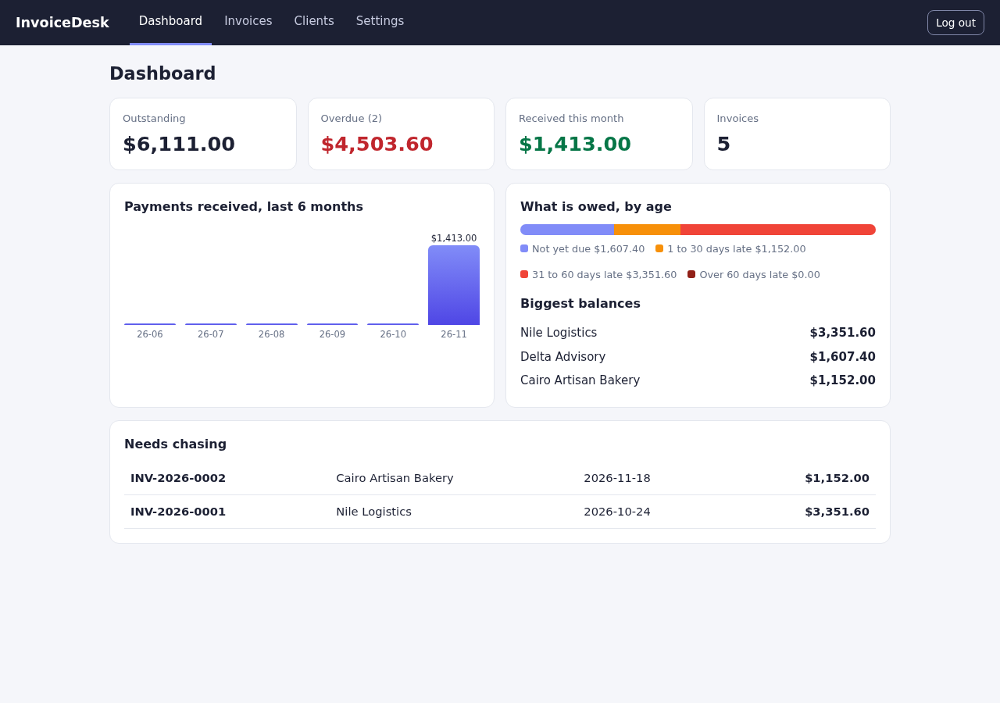
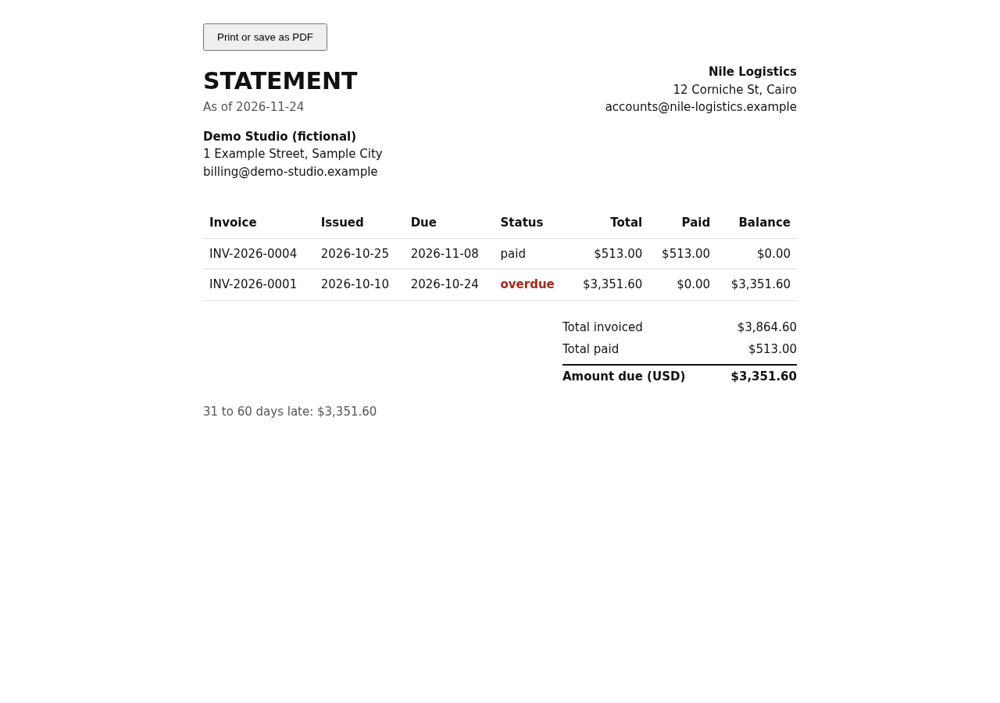
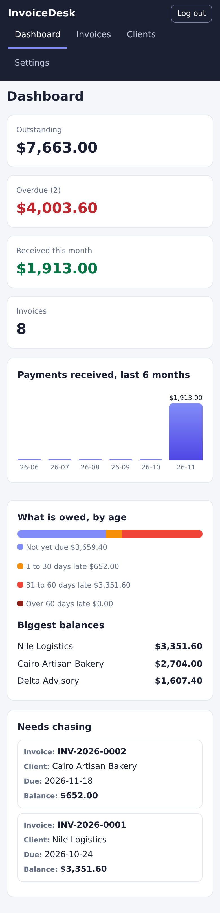

# InvoiceDesk

Clients, invoices, payments and a receivables dashboard for freelancers and small agencies. Local demo project. Demo clients and amounts are fictional.

_Screenshots of the running app with fictional demo data (captured from the real app in Chrome)._

## Run
Needs Node 22 or newer. No packages to install.

    npm start                  # http://127.0.0.1:3100
    SEED_DEMO=1 npm start      # same, plus fictional demo data on a brand-new database
    npm test                   # 20 automated tests
    node docs/e2e.js           # real server + real Chrome run with a restart (needs google-chrome)

First run: open the page and create your account (username, password of at least 10 characters). That form only works while no account exists. There are no default credentials.
Environment: `PORT` (3100), `HOST` (127.0.0.1, local only), `DB` (invoices.db), `BUSINESS_TZ` (Africa/Cairo) and `CURRENCY` (USD), both read when the database is first created.

## What it does
- Dashboard: outstanding, overdue, received this month, 6-month payments chart, what is owed by age, biggest balances, a "needs chasing" list.
- Invoices: create with line items (decimal quantities), tax percent and live totals; numbering INV-YYYY-0001 per year; draft, sent, partial, overdue, paid and void states; record payments (overpayment refused); void unpaid invoices; filter and search; CSV export; print view that can be saved as PDF from the browser.
- Edit drafts in place (number kept), duplicate any invoice into a new draft, copy a polite reminder text for overdue invoices.
- Clients: add and list with balance owed. Printable statement of account per client (sent invoices, paid, balance due, age of what is late).
- Settings: your business name, address, email and optional tax/registration number, printed on every invoice. The print view labels amounts with the currency code. Nothing here checks tax rules. "Mark as sent" only changes the status in this app, no email is sent.
Money is stored as integer cents, so totals do not drift. Overdue and "today" follow the business time zone, not the server's UTC date. Payments are recorded in one transaction, so two simultaneous payments cannot overpay an invoice (tested).

## Limits
Not security-reviewed; serve over HTTPS before real use (session cookie is not marked Secure). One user role, no password reset, no email sending, no online payment, no credit notes, no multi-currency (one currency per database), sent invoices cannot be edited (void and re-issue; drafts can be edited), paid invoices cannot be voided. Rate limits are in memory per process. No PDF generation on the server; the print view uses the browser.

## Browser demo
`demo/` is a browser-only demo build: it runs this app's own `core.js` and `server.js` request handler inside the page, with SQLite compiled to WebAssembly ([sql.js](https://github.com/sql-js/sql.js)). Nothing is sent to a server. Each visitor gets their own fictional data, stored in that browser's localStorage, with a "Reset demo data" button. The demo signs in automatically with a built-in demo user and uses a stand-in for password hashing, so it is not a model of the real app's login. Serve the `demo/` folder from any static host. Rebuild it with `node tools/demo-build/build.js` (see the header of that file for arguments).

## Hosting for real use
Serve it behind HTTPS and set `COOKIE_SECURE=1` so the session cookie is marked Secure. Responses send `X-Frame-Options: DENY` and `Referrer-Policy: no-referrer`. Do not expose a fresh database to the internet: the first visitor to open the setup page becomes the owner.
